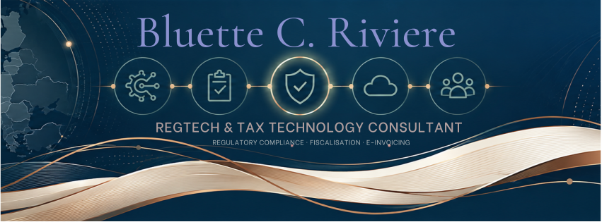

# Bluette C. Riviere

**RegTech & Tax Technology Consultant**  
Regulatory compliance · Fiscalisation · E-invoicing · Enterprise software

I work at the intersection of **regulatory requirements, enterprise software and technology delivery**. My work focuses on helping software providers understand complex compliance obligations and translate them into clear technical, functional and operational requirements.

My background combines regulatory compliance, fiscalisation, technical auditing, software ecosystems and cross-functional project delivery. I am particularly interested in the practical connection between regulation, product design and the systems that make compliant business processes work.

This GitHub profile brings together practical projects, technical explorations and documentation-led work across RegTech and enterprise technology.

---

## Areas of focus

| RegTech & Tax Technology | Enterprise Technology |
| --- | --- |
| French POS fiscalisation and NF525 | Enterprise application ecosystems |
| E-invoicing and e-reporting | APIs and application integration |
| VAT digitalisation and CTCs | Identity and access management concepts |
| Regulatory implementation | Integration architecture and workflows |
| Compliance auditing and documentation | Technical specifications and enablement |

## Selected projects

### [Enterprise Integration Lab](https://github.com/Bluette-C-Riviere/enterprise-integration-lab)

A practical learning and portfolio project exploring enterprise integration concepts, architecture and implementation patterns.

**Topics:** SSO · SAML · OAuth 2.0 · OIDC · SCIM · ETL/ELT · iPaaS · MuleSoft · Workato

The focus is on understanding how enterprise systems connect, how data moves between applications, and how integration choices affect business processes.

### [Prismatic Nocturne — Firefox Theme](https://github.com/Bluette-C-Riviere/prismatic-nocturne-firefox-theme)

A personal interface-design project: a minimalist Firefox theme built around a restrained palette and a calm browsing experience.

**Topics:** visual design · theme configuration · asset preparation · packaging · project documentation

## Technical toolkit

**Web technologies**  
Astro · TypeScript · HTML · CSS · Tailwind CSS

**Enterprise integration — currently exploring**  
APIs · SAML · OAuth 2.0 · OIDC · JWT · SCIM · ETL/ELT · iPaaS

**Tools and workflow**  
Git · GitHub · Markdown · Visual Studio Code

> I distinguish between technologies used in practical projects and technologies I am currently studying or exploring. The integration topics above reflect an active learning track, not a claim of production-level implementation experience.

## Open-source exploration

I also explore and contribute to existing open-source projects, including [watermarks-remover](https://github.com/Bluette-C-Riviere/watermarks-remover). I treat this as collaborative exploration rather than presenting the underlying project as my original work.

## Current interests

- European VAT digitalisation and regulatory change
- E-invoicing, e-reporting and Continuous Transaction Controls
- RegTech product design and compliance-by-design
- Enterprise integration and API ecosystems
- Identity, access management and SaaS architecture
- Technical documentation and solution delivery

## Connect

[LinkedIn](https://www.linkedin.com/in/bluette-chaintreau-riviere) · [GitHub](https://github.com/Bluette-C-Riviere)

---

Exploring the intersection of regulation, business processes and technology.
