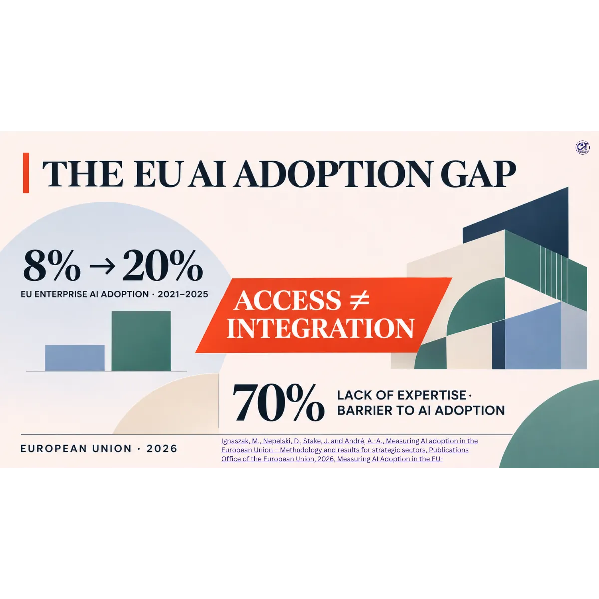

# The EU's AI Adoption Gap

STRATEGIC PERSPECTIVES · EUROPEAN UNION · NOVEMBER 2026

## Why Wider Access Does Not Yet Translate into Deeper Business Integration

Artificial intelligence adoption across the European Union is accelerating. However, wider access to AI technologies does not necessarily translate into deeper integration into business operations.

Drawing on the European Commission Joint Research Centre's 2026 report, *Measuring AI Adoption in the European Union: Methodology and Results for Strategic Sectors*, this analysis examines the distinction between the adoption of accessible AI tools and their integration into core business activities.

The article explores the organisational, technological and governance capabilities required to move beyond experimentation towards meaningful, sustainable AI integration.

## Article overview

Between 2021 and 2025, the proportion of EU enterprises using at least one AI technology increased from 8% to 20%.

However, adoption remains uneven. The growing use of accessible AI applications does not necessarily indicate that businesses have integrated AI into production, research, logistics or other operational processes.

This analysis considers what this distinction means for European business competitiveness, digital transformation and responsible technology adoption.

## Key areas examined

- European AI adoption trends and the distinction between access and integration
- Differences between accessible AI tools and operational AI implementation
- Organisational and technological maturity
- Data infrastructure, expertise and digital capabilities
- Governance, regulatory uncertainty and responsible AI adoption
- Implications for European businesses and technology providers
- Priorities for moving from experimentation towards deeper integration

## Read the full analysis

[Open the complete analysis](./article.md)

---

Strategic perspectives · European Union · November 2026
