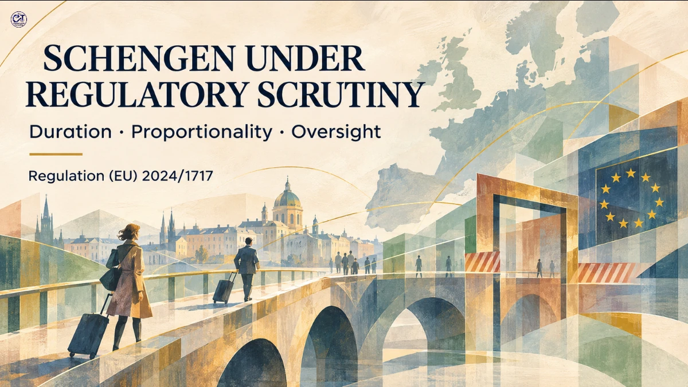

# The Revised Schengen Borders Code

REGULATORY INTELLIGENCE · EUROPEAN UNION / SCHENGEN AREA · 6 NOVEMBER 2026

## Duration Limits, Proportionality and Regulatory Oversight

An analysis of Regulation (EU) 2024/1717, examining the revised rules governing temporary internal border controls, duration limits, proportionality assessments and European Commission oversight.

## Article overview

The revision of the Schengen Borders Code reinforces the exceptional nature of temporary internal border controls through more structured duration limits, strengthened proportionality requirements and additional oversight mechanisms.

This analysis examines the regulatory changes and their implications for Member States, cross-border regions and regulatory compliance professionals.

## Key areas examined

- Regulatory background and the revised Schengen Borders Code
- Categories of serious threats and conditions for reinstating controls
- Revised duration limits under Article 25a
- Necessity and proportionality assessments under Article 26
- Notification, consultation and European Commission oversight
- Economic and territorial consequences for cross-border regions
- Regulatory implications and monitoring priorities

## Read the full analysis

[Open the complete regulatory analysis](./article.md)

---

Regulatory analysis · European Union · 6 November 2026
